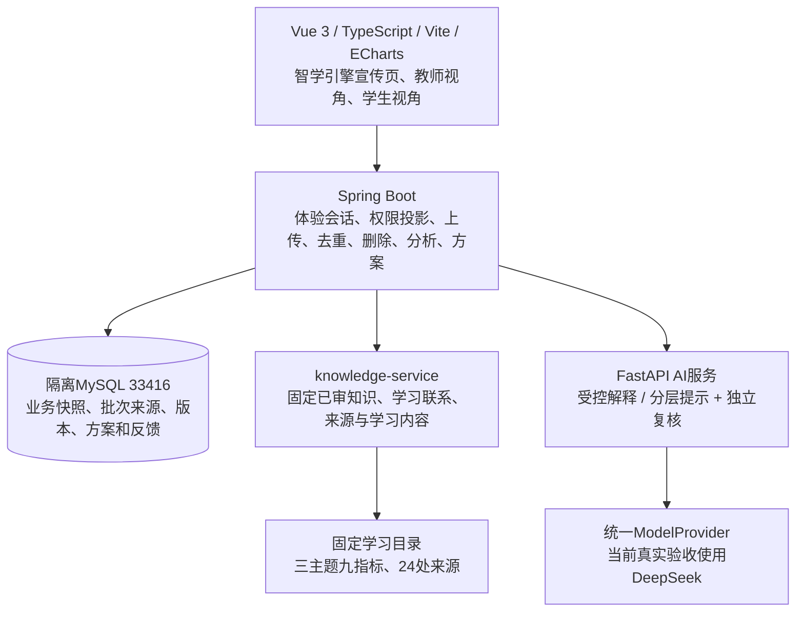

# 智学引擎当前架构

更新：2026-11-11，独立双端体验版本。入口：http://127.0.0.1:18090/。

浏览器只调用Spring `/api/companion-experience/**`。体验令牌只用于该路径，不能当作原大创系统的教师JWT。原大创认证和页面保留。

上传解析、修订选择、去重、有效分母、得分率和覆盖判断由程序计算，使用输入已有评分。模型不修改原成绩，不替代确定性统计。新题版本与旧作答分开保存；后续修订优先沿用同事件或测验已明确的题目版本，真正歧义留待处理。

后台固定学习目录已按三主题九指标完成本机内容核对，15条教材摘录按物理页匹配，课标扫描页62/63已目视核对，共24处来源。前置关系用于核查，不能单凭下游失分判定上游薄弱。本机核对不等于教师专业签字或官方评审。

知识服务拥有这些知识与来源。通用教材建图发布流程中另有22节点/12关系的候选资产尚未发布，旧发布图仍保留B02版本；普通双端体验使用已审固定学习目录，不把候选当成正式发布。

当前图谱/知识内容采用JSON持久化，未声称本轮上线Neo4j。教材不写入ChromaDB，也不做教材embedding。原始作答/过程在受保护内部用于校验和覆盖标志，外部生成Provider投影剥离原文。真实验收覆盖教师PLAN和学生HINT各一例，每例均经过生成与独立复核。

